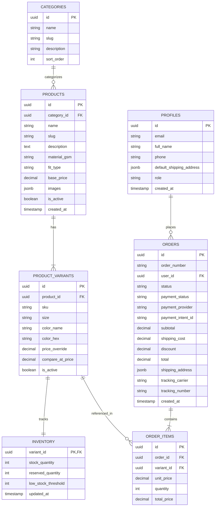

# Especificación de Arquitectura de Software - E-commerce D2C Gymbees
**Plataforma:** Next.js (App Router) + Supabase (PostgreSQL) + Vercel + Mercado Pago / Stripe  
**Equipo:** 2 Ingenieros (1 Frontend + 1 Backend con capacidades Fullstack)  
**Herramientas de IA:** Antigravity (Diseño & Arquitectura), Cursor (Frontend), Claude Code (CLI/Backend/Migraciones)  
**Autor:** Principal Software Architect  

---

## 1. Validación y Viabilidad del Stack

### 1.1. Análisis Crítico: Custom Stack (Next.js + Supabase) vs. SaaS Cerrado (Shopify)

Para un equipo ágil de **2 desarrolladores**, la decisión de construir un e-commerce desde cero versus usar un SaaS como Shopify tiene implicaciones profundas:

```
┌─────────────────────────────────────────────────────────────────────────────┐
│                       COMPARATIVA DE ENFOQUES TÉCNICOS                      │
├─────────────────────────┬───────────────────────────────────────────────────┤
│ Enfoque                 │ Ventajas / Desventajas                            │
├─────────────────────────┼───────────────────────────────────────────────────┤
│ A. Shopify Clásico      │ (+) Checkout robusto, logística resuelta.          │
│    (Liquid / Dawn)      │ (-) Rígido, costo mensual de apps ($100-$300 USD),│
│                         │     pésima experiencia de drops interactivos.     │
├─────────────────────────┼───────────────────────────────────────────────────┤
│ B. Full Custom          │ (+) 0% comisión mensual de plataforma, control    │
│    (Next.js + Supabase) │     total de UX/UI, mecánicas de Drops avanzadas. │
│    [STACK SELECCIONADO] │ (-) Carga operativa: el equipo debe programar     │
│                         │     inventario atómico, checkout y admin panel.   │
├─────────────────────────┼───────────────────────────────────────────────────┤
│ C. Headless Shopify     │ (+) Mantiene checkout/backend de Shopify con FE   │
│    (Next.js + Storefront│     a la medida en Next.js.                       │
│     API)                │ (-) Costo de plan Shopify + complejidad de sync.  │
└─────────────────────────┴───────────────────────────────────────────────────┘
```

### 1.2. Veredicto del Arquitecto
**El stack seleccionado (Next.js + Supabase + Vercel + Stripe/Mercado Pago) es totalmente viable y altamente competitivo para Gymbees**, siempre y cuando se respete una regla de oro: **KISS & YAGNI**.
* **Por qué sí es viable:**
  1. **Velocidad multiplicada por IA:** Con herramientas como Cursor y Claude Code operando sobre contratos de TypeScript estrictos, un equipo de 2 ingenieros puede producir código con la velocidad de un equipo de 5 personas.
  2. **Costo operativo inicial casi nulo:** Supabase (Tier Free/Pro $25/mes) + Vercel (Hobby/Pro $20/mes) vs. Shopify + Apps ($150-$350/mes en apps de tallas, reviews, drawer carts, etc.).
  3. **Performance Edge:** Next.js Server Components (RSC) entrega TTFB < 150ms y puntajes Core Web Vitals de 95+, reduciendo el costo por adquisición (CAC) en pauta publicitaria de Meta/TikTok.
* **El Peligro Oculto (Anti-patrón a evitar):**
  * **No construir un "Shopify Admin gigante".** Para el MVP, la gestión de inventario y pedidos debe apoyarse directamente en **Supabase Studio** y una mini-interfaz interna básica en shadcn/ui. Invertir 2 meses creando un panel administrativo complejo antes de validar ventas es un error fatal.

---

## 2. Modelo de Datos Relacional (PostgreSQL en Supabase)

El catálogo de ropa deportiva requiere soportar dos dimensiones críticas: **Talla** y **Color**, con seguimiento de stock unitario por variante (SKU único) e integridad referencial estricta.



### 2.1. Definición DDL Esencial (PostgreSQL)

```sql
-- Habilitar extensión UUID
CREATE EXTENSION IF NOT EXISTS "uuid-ossp";

-- 1. Perfiles de usuario (vinculados a auth.users de Supabase)
CREATE TABLE public.profiles (
    id UUID PRIMARY KEY REFERENCES auth.users(id) ON DELETE CASCADE,
    email TEXT NOT NULL,
    full_name TEXT,
    phone TEXT,
    default_shipping_address JSONB,
    role TEXT NOT NULL DEFAULT 'customer' CHECK (role IN ('customer', 'admin')),
    created_at TIMESTAMPTZ NOT NULL DEFAULT timezone('utc'::text, now()),
    updated_at TIMESTAMPTZ NOT NULL DEFAULT timezone('utc'::text, now())
);

-- 2. Categorías
CREATE TABLE public.categories (
    id UUID PRIMARY KEY DEFAULT uuid_generate_v4(),
    name TEXT NOT NULL,
    slug TEXT NOT NULL UNIQUE,
    description TEXT,
    sort_order INT DEFAULT 0,
    created_at TIMESTAMPTZ NOT NULL DEFAULT timezone('utc'::text, now())
);

-- 3. Productos (Catálogo Base)
CREATE TABLE public.products (
    id UUID PRIMARY KEY DEFAULT uuid_generate_v4(),
    category_id UUID REFERENCES public.categories(id) ON DELETE SET NULL,
    name TEXT NOT NULL,
    slug TEXT NOT NULL UNIQUE,
    description TEXT,
    material_gsm TEXT, -- Ej. '240 GSM Algodón Peinado'
    fit_type TEXT CHECK (fit_type IN ('oversized', 'compression', 'regular', 'athletic')),
    base_price DECIMAL(10, 2) NOT NULL CHECK (base_price > 0),
    images JSONB NOT NULL DEFAULT '[]'::jsonb, -- Array de URLs en Supabase Storage
    is_active BOOLEAN NOT NULL DEFAULT true,
    created_at TIMESTAMPTZ NOT NULL DEFAULT timezone('utc'::text, now()),
    updated_at TIMESTAMPTZ NOT NULL DEFAULT timezone('utc'::text, now())
);

-- 4. Variantes de Producto (Talla / Color / SKU)
CREATE TABLE public.product_variants (
    id UUID PRIMARY KEY DEFAULT uuid_generate_v4(),
    product_id UUID NOT NULL REFERENCES public.products(id) ON DELETE CASCADE,
    sku TEXT NOT NULL UNIQUE, -- Ej. 'GB-NOLAN-BLK-L'
    size TEXT NOT NULL CHECK (size IN ('XS', 'S', 'M', 'L', 'XL', '2XL', 'OS')),
    color_name TEXT NOT NULL,
    color_hex TEXT NOT NULL,
    price_override DECIMAL(10, 2) CHECK (price_override > 0),
    compare_at_price DECIMAL(10, 2), -- Precio tachado
    is_active BOOLEAN NOT NULL DEFAULT true,
    created_at TIMESTAMPTZ NOT NULL DEFAULT timezone('utc'::text, now()),
    CONSTRAINT unique_product_size_color UNIQUE (product_id, size, color_name)
);

-- 5. Inventario por Variante
CREATE TABLE public.inventory (
    variant_id UUID PRIMARY KEY REFERENCES public.product_variants(id) ON DELETE CASCADE,
    stock_quantity INT NOT NULL DEFAULT 0 CHECK (stock_quantity >= 0),
    reserved_quantity INT NOT NULL DEFAULT 0 CHECK (reserved_quantity >= 0),
    low_stock_threshold INT NOT NULL DEFAULT 3,
    updated_at TIMESTAMPTZ NOT NULL DEFAULT timezone('utc'::text, now())
);

-- 6. Órdenes
CREATE TABLE public.orders (
    id UUID PRIMARY KEY DEFAULT uuid_generate_v4(),
    order_number TEXT NOT NULL UNIQUE, -- Ej. 'GB-2026-1042'
    user_id UUID REFERENCES public.profiles(id) ON DELETE SET NULL, -- Permite guest checkout
    customer_email TEXT NOT NULL,
    status TEXT NOT NULL DEFAULT 'pending' CHECK (status IN ('pending', 'processing', 'shipped', 'delivered', 'cancelled')),
    payment_status TEXT NOT NULL DEFAULT 'unpaid' CHECK (payment_status IN ('unpaid', 'paid', 'refunded', 'failed')),
    payment_provider TEXT CHECK (payment_provider IN ('mercadopago', 'stripe', 'kueski')),
    payment_intent_id TEXT UNIQUE,
    subtotal DECIMAL(10, 2) NOT NULL CHECK (subtotal >= 0),
    shipping_cost DECIMAL(10, 2) NOT NULL DEFAULT 0.00,
    discount DECIMAL(10, 2) NOT NULL DEFAULT 0.00,
    total DECIMAL(10, 2) NOT NULL CHECK (total >= 0),
    shipping_address JSONB NOT NULL,
    tracking_carrier TEXT,
    tracking_number TEXT,
    created_at TIMESTAMPTZ NOT NULL DEFAULT timezone('utc'::text, now()),
    updated_at TIMESTAMPTZ NOT NULL DEFAULT timezone('utc'::text, now())
);

-- 7. Items de la Orden (Snapshot histórico de compra)
CREATE TABLE public.order_items (
    id UUID PRIMARY KEY DEFAULT uuid_generate_v4(),
    order_id UUID NOT NULL REFERENCES public.orders(id) ON DELETE CASCADE,
    variant_id UUID REFERENCES public.product_variants(id) ON DELETE SET NULL,
    product_name TEXT NOT NULL,
    variant_info TEXT NOT NULL, -- Ej. 'Negro / L'
    unit_price DECIMAL(10, 2) NOT NULL,
    quantity INT NOT NULL CHECK (quantity > 0),
    total_price DECIMAL(10, 2) NOT NULL
);

-- Índices estratégicos para performance
CREATE INDEX idx_products_slug ON public.products(slug);
CREATE INDEX idx_products_active ON public.products(is_active);
CREATE INDEX idx_variants_product ON public.product_variants(product_id);
CREATE INDEX idx_orders_user ON public.orders(user_id);
CREATE INDEX idx_orders_status ON public.orders(status);
```

---

## 3. Estrategia de Seguridad y Confiabilidad

### 3.1. Row Level Security (RLS) en Supabase
En Supabase, habilitar RLS es el perímetro de defensa principal. El cliente web (Next.js con `@supabase/supabase-js`) **nunca debe tener permisos de escritura directos sobre órdenes, inventario o precios**.

```sql
-- Activar RLS en todas las tablas
ALTER TABLE public.profiles ENABLE ROW LEVEL SECURITY;
ALTER TABLE public.categories ENABLE ROW LEVEL SECURITY;
ALTER TABLE public.products ENABLE ROW LEVEL SECURITY;
ALTER TABLE public.product_variants ENABLE ROW LEVEL SECURITY;
ALTER TABLE public.inventory ENABLE ROW LEVEL SECURITY;
ALTER TABLE public.orders ENABLE ROW LEVEL SECURITY;
ALTER TABLE public.order_items ENABLE ROW LEVEL SECURITY;

-- REGLAS DE LECTURA PÚBLICA (Catálogo visible para todos)
CREATE POLICY "Public Read Categories" ON public.categories FOR SELECT USING (true);
CREATE POLICY "Public Read Products" ON public.products FOR SELECT USING (is_active = true);
CREATE POLICY "Public Read Variants" ON public.product_variants FOR SELECT USING (is_active = true);

-- REGLA PARA INVENTARIO (Solo lectura de disponibilidad, no mutación directa)
CREATE POLICY "Public Read Stock" ON public.inventory FOR SELECT USING (true);

-- REGLA PARA PERFILES
CREATE POLICY "Users can view own profile" ON public.profiles FOR SELECT USING (auth.uid() = id);
CREATE POLICY "Users can update own profile" ON public.profiles FOR UPDATE USING (auth.uid() = id);

-- REGLAS DE ÓRDENES
-- El usuario solo ve sus propias órdenes
CREATE POLICY "Users can view own orders" ON public.orders 
FOR SELECT USING (auth.uid() = user_id);

CREATE POLICY "Users can view own order items" ON public.order_items 
FOR SELECT USING (
    EXISTS (
        SELECT 1 FROM public.orders 
        WHERE orders.id = order_items.order_id 
        AND orders.user_id = auth.uid()
    )
);

-- INSERCIÓN Y ACTUALIZACIÓN DE ÓRDENES:
-- BLOQUEADAS para clientes anónimos y autenticados.
-- Solo se ejecutan a través de Next.js Server Actions / Webhook usando SUPABASE_SERVICE_ROLE_KEY.
```

### 3.2. Prevención de Manipulación de Precios desde el Cliente
* **Vulnerabilidad Común:** Enviar desde el frontend el precio total calculado en React (`fetch('/api/checkout', { body: { total: 649 } })`). Un atacante puede interceptar la petición y cambiar el total a `$1.00 MXN`.
* **Solución Arquitectónica:**
  1. El cliente envía únicamente: `items: [{ variant_id: "...", quantity: 1 }]`.
  2. El servidor (Next.js Server Action / Route Handler) consulta en PostgreSQL los precios canónicos vigentes en `product_variants`.
  3. El servidor calcula el `subtotal`, aplica reglas de envío gratis (`subtotal >= 1299 ? 0 : 150`) y genera la preferencia de pago en la API de Mercado Pago / Stripe con el monto exacto certificado por el backend.

### 3.3. Procesamiento Atómico de Órdenes y Mitigación de Race Conditions (Drops Masivos)
En un lanzamiento masivo de Gymbees (ej. Drop *Nolan Grayson*, 50 personas queriendo comprar las últimas 3 playeras talla L al mismo tiempo), se produce una condición de carrera (*race condition*). Si dos transacciones leen `stock = 1` simultáneamente, ambas se aprueban y se produce sobreventa (*overselling*).

**Solución: Función Atómica en PostgreSQL con Bloqueo de Fila (`SELECT FOR UPDATE` o Mutación Condicional Directa):**

```sql
CREATE OR REPLACE FUNCTION public.reserve_stock_for_checkout(
    p_variant_id UUID,
    p_quantity INT
) RETURNS BOOLEAN AS $$
DECLARE
    v_available_stock INT;
BEGIN
    -- Bloqueo a nivel de fila durante la transacción
    SELECT (stock_quantity - reserved_quantity) INTO v_available_stock
    FROM public.inventory
    WHERE variant_id = p_variant_id
    FOR UPDATE;

    IF v_available_stock >= p_quantity THEN
        UPDATE public.inventory
        SET reserved_quantity = reserved_quantity + p_quantity,
            updated_at = now()
        WHERE variant_id = p_variant_id;
        RETURN TRUE;
    ELSE
        RETURN FALSE;
    END IF;
END;
$$ LANGUAGE plpgsql SECURITY DEFINER;
```

### 3.4. Ciclo de Vida del Webhook de Pago e Idempotencia
```
[ Gateway (Mercado Pago / Stripe) ]
              │  (POST /api/webhooks/payment)
              ▼
    [ Next.js Route Handler ]
              │
    ┌─────────┴─────────────────────────────┐
    │ 1. Validar Firma Criptográfica HMAC  │ ➔ (Rechazar si no es auténtico)
    │ 2. Verificar Idempotencia en DB       │ ➔ (Si ya fue procesado, return 200)
    │ 3. Transacción SQL Atómica:           │
    │    - UPDATE orders SET status = 'paid'│
    │    - Reducir stock_quantity           │
    │    - Liberar reserved_quantity        │
    │ 4. Disparar Correo / WhatsApp Notif.  │
    └───────────────────────────────────────┘
```

---

## 4. Flujo de Trabajo en Paralelo para 2 Desarrolladores

Para que un **Especialista Frontend** y un **Especialista Backend** trabajen sin bloquearse mutuamente, el desacoplamiento se logra mediante **contratos de interfaz tipados en TypeScript (Single Source of Truth)**.

### 4.1. Contrato de Datos Compartido (`@/types/commerce.ts`)
Ambos desarrolladores acuerdan este archivo en el día 1. El frontendista puede simular datos con mocks exactos mientras el backendista implementa las tablas y queries.

```typescript
// types/commerce.ts

export type ProductFit = 'oversized' | 'compression' | 'regular' | 'athletic';
export type ClothingSize = 'XS' | 'S' | 'M' | 'L' | 'XL' | '2XL' | 'OS';

export interface ProductVariant {
  id: string;
  productId: string;
  sku: string;
  size: ClothingSize;
  colorName: string;
  colorHex: string;
  price: number;
  compareAtPrice?: number;
  inStock: boolean;
  stockCount: number;
}

export interface Product {
  id: string;
  name: string;
  slug: string;
  description: string;
  materialGsm: string;
  fitType: ProductFit;
  basePrice: number;
  images: string[];
  variants: ProductVariant[];
}

export interface CartItem {
  variantId: string;
  productId: string;
  name: string;
  size: ClothingSize;
  colorName: string;
  price: number;
  image: string;
  quantity: number;
}

export interface CreateCheckoutInput {
  items: Array<{
    variantId: string;
    quantity: number;
  }>;
  customer: {
    email: string;
    fullName: string;
    phone: string;
  };
  shippingAddress: {
    street: string;
    city: string;
    state: string;
    postalCode: string;
    references?: string;
  };
}

export interface CheckoutResponse {
  orderId: string;
  orderNumber: string;
  paymentUrl: string; // URL de redirección a Mercado Pago Checkout Pro o Stripe Session
}
```

### 4.2. Estrategia de Ramas Git y Ambientes de Despliegue

```
┌────────────────────────────────────────────────────────────────────────┐
│                        ESTRATEGIA GIT FLOW LEAN                        │
├────────────────────────────────────────────────────────────────────────┤
│  [main]         ➔ Producción (gymbees.com.mx)                         │
│    ▲                                                                   │
│    │ (PR con aprobación)                                               │
│  [staging]      ➔ Ambiente de Pruebas Integradas (staging.gymbees.mx)  │
│    ▲               Conectado a proyecto Supabase Staging               │
│    ├──────────────────────────────┐                                    │
│  [feat/fe-pdp-variants]      [feat/be-checkout-webhook]                │
│  (Frontend Dev en Cursor)    (Backend Dev en Claude Code)              │
│  ➔ Preview URL en Vercel     ➔ Pruebas con Supabase CLI local/branch   │
└────────────────────────────────────────────────────────────────────────┘
```

* **Vercel Preview Deployments:** Cada Pull Request genera una URL única e inmutable (`gymbees-git-feat-pdp-*.vercel.app`) para que ambos revisen visualmente antes de fusionar.
* **Supabase Local Development con Supabase CLI:** El desarrollador backend ejecuta Supabase en local mediante Docker (`npx supabase start`), lo que permite crear migraciones reproducibles (`supabase db diff -f add_orders`) sin tocar la base de datos de producción.

### 4.3. Matriz de División de Tareas

| Sprint | Especialista Frontend (Cursor / Antigravity) | Especialista Backend (Claude Code / Antigravity) |
| :--- | :--- | :--- |
| **Sprint 1: Base & Catálogo** | - Layout base con Tailwind + shadcn.<br>- Header sticky, Drawer Cart y Announcement bar.<br>- Grid de productos con Quick-Add en Home.<br>- Consumo de datos vía mocks tipados. | - Setup de Supabase (tablas, RLS, storage buckets).<br>- Script de seed con catálogo inicial de Gymbees.<br>- Server Actions para `getProducts()` y `getProductBySlug()`.<br>- Configuración de Supabase CLI y migraciones. |
| **Sprint 2: PDP & Carrito** | - Ficha de producto (PDP) interactiva.<br>- Selector de talla (Pills), swatches de color y modal de guía de medidas.<br>- Sticky Add-to-Cart móvil con sensor de scroll.<br>- Estado global de carrito (Zustand con persistencia en LocalStorage). | - Lógica de verificación de stock en tiempo real.<br>- Función RPC para validar disponibilidad de tallas.<br>- Optimización de carga de imágenes en Supabase Storage (CDN caching). |
| **Sprint 3: Checkout & Pagos** | - Formulario de checkout mobile-friendly (dirección de envío en México con autocompletado).<br>- Barra de progreso de envío gratis dinámica.<br>- Pantalla de confirmación de pedido (`/order/success`). | - Integración del SDK de Mercado Pago / Stripe Checkout.<br>- Route Handler para Webhooks de pago con validación HMAC.<br>- Transacción atómica de reserva y confirmación de inventario.<br>- Disparo de confirmación por email (Resend SDK). |
| **Sprint 4: Hardening & Go-Live** | - Auditoría de accesibilidad (a11y) y Core Web Vitals en móvil.<br>- Pruebas de microinteracciones y feedback de carga (*skeletons*). | - Auditoría de seguridad en RLS policies.<br>- Pruebas de carga concurrente en el endpoint de checkout.<br>- Configuración de dominios y variables de entorno seguras en Vercel. |
